<!-- Profile banner -->
<p align="center">
  
</p>

<h1 align="center">Hi, I'm Pham Ngoc Vu 👋</h1>

<p align="center">
  
</p>

<!-- Social links -->
<p align="center">
  <a href="https://github.com/Ngocvu2604">
    
  </a>
  <a href="https://t.me/ngocvu05">
    
  </a>
</p>

---
## 💻 About me

```console
$ whoami
Pham Ngoc Vu

$ cat profile.txt
🎓 Duy Tan University
📍 Vietnam
🌱 Learning web development and programming
🚀 Learning → Building → Sharing
```

## 🛠️ Tech I work with

<p align="center">
  <a href="https://skillicons.dev">
    
  </a>
</p>

## 📊 GitHub at a glance

<p align="center">
  
  
</p>

## 📈 Contribution overview

<p align="center">
  
</p>

<!--
## 🐍 Contribution snake

<p align="center">
  
</p>
-->

## 🚀 Galaga Contribution Graph

<p align="center">
  <picture>
    <source
      media="(prefers-color-scheme: dark)"
      srcset="https://raw.githubusercontent.com/Ngocvu2604/Ngocvu2604/galaga-output/galaga-contribution-graph-dark.svg"
    />
    <source
      media="(prefers-color-scheme: light)"
      srcset="https://raw.githubusercontent.com/Ngocvu2604/Ngocvu2604/galaga-output/galaga-contribution-graph.svg"
    />
    
  </picture>
</p>

---

<!-- Animated farewell -->
<p align="center">
  <a href="https://t.me/ngocvu05">
    
  </a>
</p>

<p align="center">
  <a href="https://t.me/ngocvu2005">
    
  </a>
</p>

<!-- Footer banner -->
<p align="center">
  
</p>
